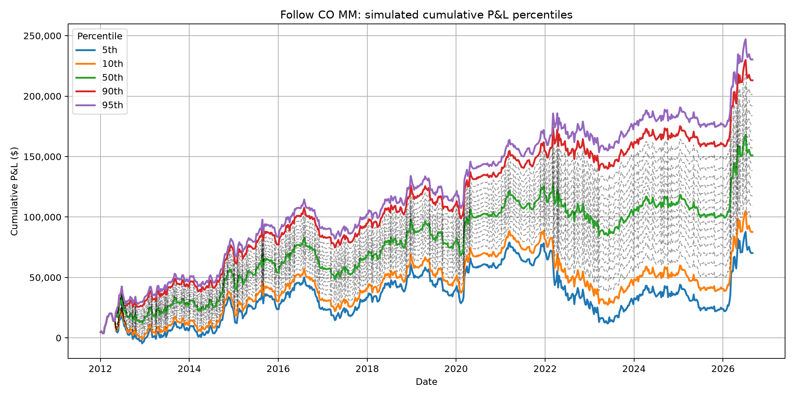
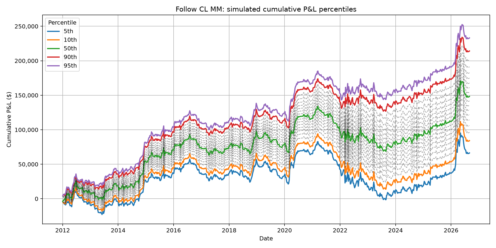

# Follow the MM flow

An exploratory moving-average crossover backtest for WTI crude oil (`CL`) and
ICE Brent crude oil (`CO`). The pipeline processes settlement prices,
expiration dates, and Commitments of Traders (CoT) positioning, then calculates
rolling-contract P&L, strategy results, parameter sensitivity, and Monte Carlo
distributions.

## Strategy

Managed-money net positioning is long positions minus short positions. For
moving-average windows `(m, n)`, the weekly signal is the sign of
`MA(m) - MA(n)`:

- `+1`: long one contract when the short moving average is higher.
- `-1`: short one contract when the short moving average is lower.
- `0`: flat when the averages are equal or unavailable.

The default backtest uses `m=1` and `n=8`. The sensitivity analysis tests
`m=1..4` and `n=8..26`. A moving average is calculated over calendar weeks,
ignoring missing reports within the window. Its initial warm-up lasts the full
number of calendar weeks, and later missing weeks do not restart the warm-up.
When the report for the preceding week is missing, the strategy stays flat for
the next trading week.

Reports are assumed to be available by Friday of their report week. Positions
are set at the following Monday close, or the next available settlement close
in that week if Monday is missing. The position held at the previous close
earns the current day's P&L.

## Latest figures

The heatmaps show annualized weekly Sharpe ratios for each `(m, n)` pair. The
Monte Carlo charts show cumulative dollar-P&L percentiles from one million
trials. In each trial, one of the 76 pairs is selected uniformly and
independently for each holding week.

### ICE Brent (`CO`)

| Sensitivity | Monte Carlo |
|---|---|
|  |  |

### WTI (`CL`)

| Sensitivity | Monte Carlo |
|---|---|
|  |  |

## Data and execution

Use Python 3.10 or later:

```sh
python3 -m venv .venv
source .venv/bin/activate
python -m pip install -r requirements.txt
python src/process_data.py
python src/backtest.py
python -m unittest discover -s tests
```

Place the settlement/expiration workbook and annual ICE `COTHistYYYY.csv`
files in `data/raw/`. The data processor also downloads public CFTC futures-only
legacy and disaggregated reports for WTI, so it needs internet access. It writes
settlements, expirations, positions, and the downloaded CFTC tables to
`data/processed/`.

The backtest retains data before the reporting period to initialize rolling
contracts and moving averages. The current configured reporting period is
2012-01-01 through 2026-08-31. Results are saved in `outputs/`:

- `*_backtest.csv`: daily rolling P&L, strategy position, strategy P&L, and
  cumulative strategy P&L for the default `(1, 8)` pair.
- `*_sensitivity.csv`: annualized weekly Sharpe ratios by `(m, n)`.
- `*_monte_carlo_percentiles.csv`: cumulative P&L percentiles by week.
- `*_sensitivity.png` and `*_monte_carlo.png`: figures embedded above.

The sensitivity Sharpe ratio uses sample standard deviation and annualizes
weekly P&L by `sqrt(365/7)`. The Monte Carlo simulation uses a fixed random seed
for reproducibility and vectorizes across trials while processing one holding
week at a time.

## Assumptions and limitations

- The positioning data has report dates but not actual publication dates. The
  Friday-release assumption can introduce look-ahead around delayed holiday
  releases.
- Settlement prices are treated as execution prices. Transaction costs,
  slippage, financing, margin, and roll costs are excluded.
- Results are marked to the final close, not forcibly liquidated. Dollar P&L
  is not a return on capital.
- The existing generic-contract roll convention is retained. P&L uses the
  price change of the same underlying contract multiplied by 1,000 barrels.
- Missing contract prices are forward-filled on dates with at least one
  settlement, within the common coverage of all three generic contracts.
  Filled dates and contracts are printed; stale prices may distort P&L or
  rolling. An expiration without a settlement observation raises an error.

Raw and processed data and CSV outputs are excluded from Git. The four PNG
figures shown above are included. Obtain source data separately and check its
distribution rights.
