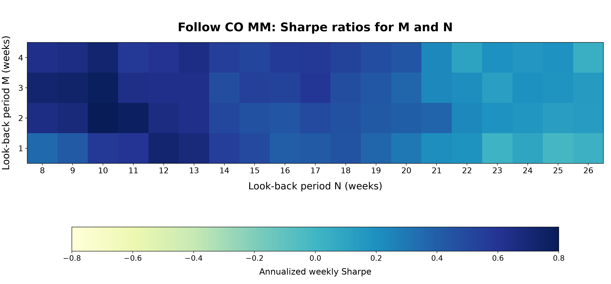
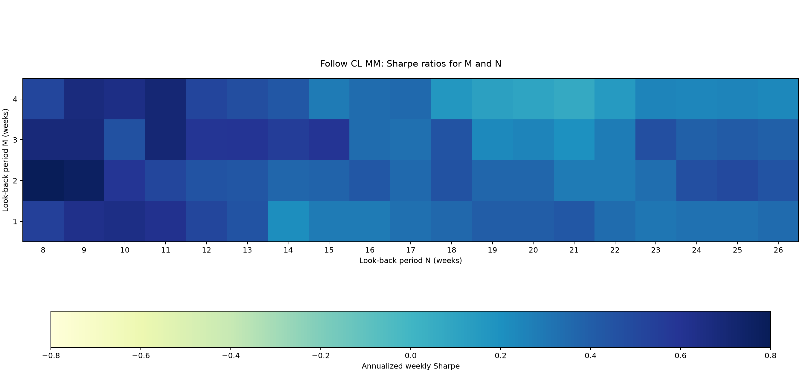

# Follow the MM flow

An exploratory moving-average crossover backtest for ICE Brent crude oil (`CO`)
and CME WTI crude oil (`CL`). The pipeline processes settlement prices,
expiration dates, and Commitments of Traders (CoT) positioning, then calculates
rolling-contract P&L and parameter sensitivity. A Monte Carlo analysis randomly
selects a follow-the-flow moving-average pair each week from the tested parameter
range and evaluates the results under different transaction-cost scenarios.

## Strategy

Managed-money net positioning is long positions minus short positions. For
moving-average windows `(m, n)` measured in weeks, the weekly signal is the sign of
`MA(m) - MA(n)`:

- `+1`: long one contract when the short moving average is higher.
- `-1`: short one contract when the short moving average is lower.
- `0`: flat when the averages are equal or unavailable.

Brent (`CO`) and WTI (`CL`) are backtested separately, one futures contract
(1,000 barrels) at a time. Their P&L is not combined into a two-market
portfolio. Contract rolls use the generic-contract convention described below.

The sensitivity analysis tests `m=1..4` and `n=8..26`; the window ranges
are configured in [src/config.py](src/config.py). A moving average is calculated
over calendar weeks, ignoring missing reports within the window. Its initial
warm-up lasts the full number of calendar weeks, and later missing weeks do not
restart the warm-up. 

Reports are assumed to be available by Friday of their report week. Positions
are set at the following Monday close, or the next available settlement close
in that week if Monday is missing. The position held at the previous close
earns the current day's P&L.

## Sensitivity: zero transaction costs

The heatmaps show annualized weekly Sharpe ratios for each `(m, n)` pair.

### ICE Brent (`CO`) sensitivity



### WTI (`CL`) sensitivity



## Monte Carlo: zero transaction costs

The charts show cumulative dollar-P&L percentiles from one million trials. In
each trial, one of the 76 pairs is selected uniformly and independently for
each holding week.

### ICE Brent (`CO`) Monte Carlo


### WTI (`CL`) Monte Carlo


## Monte Carlo medians by cost and period

These are medians across the same one million random-pair trials. Values are
annualized net P&L for one crude oil futures contract (1,000 barrels), shown in
thousands of dollars and rounded to one decimal. For example, 11.9 means
$11,900 per year. Costs are dollars per barrel per executed leg. The tables are
a snapshot using data through 2026-08-31; they are not updated automatically when
the code is rerun.

For each pair, daily P&L is first reduced by the costs of that pair's own
position changes, rolls and final liquidation. The simulation then selects a
pair for each holding week and sums its independently costed P&L by calendar
period. Weekly P&L includes the next rebalance day's P&L and costs; if a week
spans periods, the daily amounts are assigned to their actual dates. Each
cell is the median of the period totals across trials, then annualized.

**Limitation:** selecting a different pair can change the simulated position,
but the independently costed series do not charge the actual trades caused by
switching pairs. Conversely, a pair's standalone trades can be charged even
when the previous selected pair would have held the same position. These
results are not an execution-cost estimate for a dynamically switched strategy.

### Brent

| Cost | 2012–21 | 2022 | 2023 | 2024 | 2025 | Iran war window | Jan–Aug 2026 | Full |
|---:|---:|---:|---:|---:|---:|---:|---:|---:|
| $0.00 | 11.9 | -21.8 | 10.2 | 8.2 | -9.8 | 76.6 | 69.4 | 10.3 |
| $0.02 | 11.3 | -22.6 | 9.4 | 7.5 | -10.6 | 76.0 | 68.8 | 9.6 |
| $0.05 | 10.3 | -23.7 | 8.3 | 6.4 | -11.7 | 75.3 | 67.9 | 8.6 |
| $0.10 | 8.6 | -25.6 | 6.3 | 4.7 | -13.6 | 74.0 | 66.3 | 6.9 |
| $0.20 | 5.3 | -29.4 | 2.5 | 1.4 | -17.4 | 71.4 | 63.3 | 3.5 |

### WTI

| Cost | 2012–21 | 2022 | 2023 | 2024 | 2025 | Iran war window | Jan–Aug 2026 | Full |
|---:|---:|---:|---:|---:|---:|---:|---:|---:|
| $0.00 | 9.8 | -15.8 | -1.9 | 10.6 | 19.4 | 53.7 | 54.1 | 10.1 |
| $0.02 | 9.1 | -16.5 | -2.7 | 9.8 | 18.8 | 53.0 | 53.5 | 9.4 |
| $0.05 | 8.0 | -17.6 | -4.0 | 8.6 | 17.8 | 51.8 | 52.5 | 8.3 |
| $0.10 | 6.3 | -19.3 | -6.0 | 6.7 | 16.1 | 49.9 | 50.7 | 6.5 |
| $0.20 | 2.7 | -22.7 | -10.0 | 2.8 | 12.8 | 46.0 | 47.1 | 3.0 |

The Iran war window is the user-defined March–August 2026 interval; full is
2012 through August 2026. Columns overlap. Short-period figures are annualized,
not actual profits. The Monte Carlo percentiles describe random parameter
choices on this historical price path; they are not confidence intervals or
forecasts.

## Full-sample median-path performance

The following tables describe the weekly pointwise median cumulative net-P&L
path for 2012-01-01 through 2026-08-31. Net P&L is the ending median;
volatility, Sharpe, maximum drawdown and profit factor are calculated from
the median path, not as medians of the individual trials' metrics. The
independently costed-pair limitation above also applies here.

Dollar values are in thousands for one crude oil futures contract (1,000 barrels).
Net P&L is for the full sample; net P&L per year and volatility are annualized.
Drawdown is measured weekly and can miss within-week troughs. Profit factor uses
weekly changes, not completed trades. Costs are dollars per barrel per executed
leg.

The 95% HAC range is a **descriptive calculation** on the synthetic median
path's weekly changes, in annualized thousands of dollars for one contract. It
is not valid inference for a realizable strategy or for the median estimator.

### Brent

| Cost | Net P&L | Net P&L / year | Annualized volatility | Sharpe | Weekly max drawdown | Weekly profit factor | 95% HAC range (descriptive) |
|---:|---:|---:|---:|---:|---:|---:|---:|
| $0.00 | 150.92 | 10.29 | 20.56 | 0.50 | 42.92 | 1.23 | [0.03, 20.55] |
| $0.02 | 140.92 | 9.61 | 20.56 | 0.47 | 43.73 | 1.21 | [-0.66, 19.87] |
| $0.05 | 125.95 | 8.59 | 20.56 | 0.42 | 45.15 | 1.19 | [-1.69, 18.86] |
| $0.10 | 100.94 | 6.88 | 20.57 | 0.33 | 47.49 | 1.15 | [-3.41, 17.18] |
| $0.20 | 50.94 | 3.47 | 20.60 | 0.17 | 58.35 | 1.07 | [-6.87, 13.81] |

### WTI

| Cost | Net P&L | Net P&L / year | Annualized volatility | Sharpe | Weekly max drawdown | Weekly profit factor | 95% HAC range (descriptive) |
|---:|---:|---:|---:|---:|---:|---:|---:|
| $0.00 | 148.36 | 10.12 | 20.86 | 0.49 | 65.01 | 1.23 | [-0.66, 20.89] |
| $0.02 | 137.87 | 9.40 | 20.86 | 0.45 | 66.91 | 1.21 | [-1.38, 20.18] |
| $0.05 | 122.13 | 8.33 | 20.86 | 0.40 | 69.75 | 1.18 | [-2.47, 19.13] |
| $0.10 | 95.86 | 6.54 | 20.88 | 0.31 | 74.49 | 1.14 | [-4.29, 17.36] |
| $0.20 | 43.32 | 2.95 | 20.93 | 0.14 | 83.99 | 1.06 | [-7.93, 13.83] |

## Data and execution

Use Python 3.10 or later:

```sh
python3 -m venv .venv
source .venv/bin/activate
python -m pip install -r requirements.txt
python src/process_data.py
python src/backtest.py
```

Place the settlement/expiration workbook and annual ICE `COTHistYYYY.csv`
files in `data/raw/`. The data processor also downloads public CFTC futures-only
legacy and disaggregated reports for WTI, so it needs internet access. It writes
settlements, expirations, positions, and the downloaded CFTC tables to
`data/processed/`.

The backtest retains data before the reporting period to initialize rolling
contracts and moving averages. The current configured reporting period is
2012-01-01 through 2026-08-31. Results are saved in `outputs/`:

- `*_performance.csv`: weekly pointwise median Monte Carlo path performance,
  for each cost scenario and period used in the tables.
- `*_cost_period_table.csv`: median annualized Monte Carlo net P&L per contract,
  with cost scenarios as rows and periods as columns. Missing periods are blank.
- `*_sensitivity.csv`: annualized weekly Sharpe ratios by `(m, n)`.
- `*_monte_carlo_percentiles.csv`: cumulative P&L percentiles by week.
- `*_sensitivity.png` and `*_monte_carlo.png`: figures embedded above.

The sensitivity Sharpe ratio uses sample standard deviation and annualizes
weekly P&L by `sqrt(365/7)`. The Monte Carlo simulation uses a fixed random seed
for reproducibility and vectorizes across trials while processing one holding
week at a time.

## Costs and performance

Each Monte Carlo pair is evaluated at zero and $0.02, $0.05, $0.10 and $0.20
per barrel **per executed contract leg**. A $1-per-barrel price move produces
$1,000 of gross P&L for one long contract; separately, a $0.05-per-barrel cost
is $50 per executed leg. The 1,000-barrel multiplier is applied once to each
amount, not twice to P&L or costs.

A one-contract entry or exit costs one leg; a reversal costs two. Rolls close
the old contract and open the new one, costing two legs when the position is unchanged. If a position change and roll coincide, only the actual old-contract close and new-contract
open are charged; there is no double counting. `position_turnover` is the
absolute position change, and `roll_turnover` is the additional turnover
attributable to rolling after position changes have been counted. Generic
contract relabeling on expiration is not itself a trade. An initial position
is charged when it is opened in the full history, not again at a reporting
boundary. At the final available close in the configured sample, the
carried position is liquidated instead of executing a scheduled rebalance or
roll; a long or short contract costs one closing leg, and a flat position
costs nothing. There is no forced liquidation at intermediate period boundaries.
Roll detection follows the contract referenced by the next P&L interval
(`pnl_contract_at_close`). The last observation uses the internal prompt
contract state as a fallback because no subsequent interval is available.

Performance is dollar P&L per contract, not a return on capital. For each
period and cost, trial cumulative P&L is reset at the period boundary; the
median across trials is then calculated at each observed holding week.
Weekly changes are differences of successive median cumulative values.
Partial boundary weeks and weeks with zero P&L are included. Annualized net
P&L uses the inclusive calendar length of the period; volatility and Sharpe
use sample weekly standard deviation and observed holding weeks divided by
period length in years. Maximum drawdown is measured on the weekly median path, 
so it can miss within-week troughs. Weekly profit factor divides positive weekly 
changes by the absolute sum of negative weekly changes; it is not a trade-level measure.
Undefined metrics are blank.

The pointwise median can combine different trials at different dates and need
not be a realizable strategy. Turnover, average profit per completed trade and
break-even cost are therefore not attributed to this synthetic path. The
reported 95% HAC interval is a **descriptive calculation on its weekly
changes**, not valid inference for a realizable strategy or the median
estimator. It uses a normal approximation, Bartlett/Newey–West standard
errors and lag `floor(4*(weeks/100)^(2/9))`; at least eight weeks are required.

The Iran war window is **user-defined** as 2026-03-01 through the end of the
available reporting sample, currently 2026-08-31. Periods retain the positions
established before their boundaries, and costs are assigned to the date
actually traded.

## Assumptions and limitations

- The positioning data has report dates but not actual publication dates. The
  Friday-release assumption can introduce look-ahead around delayed holiday
  releases and shutdowns. The CFTC publishes a tentative
  [release schedule](https://www.cftc.gov/MarketReports/CommitmentsofTraders/ReleaseSchedule/index.htm)
  and [shutdown-delay announcements](https://www.cftc.gov/PressRoom/PressReleases/7864-19);
  ICE describes its usual publication timing in its
  [CoT notes](https://www.ice.com/publicdocs/futures/CoT_Notes.pdf). These are
  not a complete, verified historical publication-date dataset, and the
  backtest still uses the Friday assumption.
- Settlement prices are treated as execution prices. The sensitivity heatmaps
  and Monte Carlo percentile charts are zero-cost. The cost scenarios are
  illustrative execution costs, not estimates of actual spreads or slippage;
  financing, margin and other expenses are excluded.

Raw and processed data are excluded from Git. Summary CSVs and the four PNG figures are 
eligible for inclusion. Obtain source data separately and check the distribution rights for derived results.